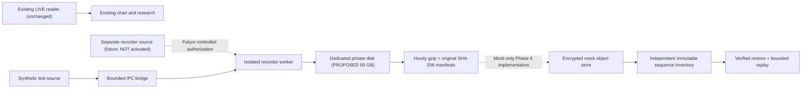

# Engine 18B — Gate 1 Phase 4 Technical Handoff

**Tracking:** [Issue #294](https://github.com/bfrye1973/frye-market-backend/issues/294) — conditional owner budget roughly **$22/month incremental**, NOT permission to provision or capture licensed data.  
**Review:** Draft PR #295, new isolated branch `engine18b-gate1-phase4-bounded-recovery-20261110`.  
**Safety:** No LIVE chart, Engine 11, Engine 22, execution, production market-data reader, Render service, or existing disk modified. No paid infrastructure, backup provider, or live source connection activated.

## 1. Architecture — synthetic proof only

The synthetic parent IPC callback stamps receipt time and copies the original payload, sends to a separate Node child, and returns without waiting on disk. Worker ACK is issued **only after buffered commit fsync and high-watermark update**. If IPC backpressure, disk failure, or process termination occurs, unresolved events are explicitly unacknowledged; the worker is marked failed. A subsequent isolated bounded restart emits recorder `GAP` if clean STOP was absent. No chart or trading execution process is wired to this code.

**Important distinction:** Today's IPC worker is synthetic-only and runs under a `/tmp` test root. It does NOT open Ironbeam, subscribe, or accept a live capture enable flag. Real independent data acquisition and backpressure policy need a later separately reviewed integration; acquiring another licensed connection may have vendor constraints.

## 2. Bounded recovery and exact replay

`engine18BoundedRecovery.js` verifies existing archive SHA-256 and manifests in 64 KiB chunks, streams gzip JSONL decompression, validates globally contiguous local sequence, scans unclosed hourly JSONL with a 16 MiB maximum individual record, truncates incomplete trailing data with file fsync, and finalizes valid records with streamed gzip + SHA-256. It compares the repaired result to the durable high-watermark and fails closed on missing acknowledged files, original manifests, or corrupted complete lines. Normal post-recovery sequence/receipt fields and raw text/binary envelopes are preserved, and an unclean previous run gains a durable recorder `GAP`.

The worker uses `Engine18BufferedRecorder.openBounded()` / `Engine18RawRecorder.openBounded()`. Legacy synchronous APIs remain for small existing Gate 1 tests, with a strict 64 MiB per-file fail-closed limit for their initialization; **they must not be used in live continuous capture**. Historical replay remains available through `scanEngine18ReplayBounded()` and never needs a whole decompressed event list.

**Limitations:** Recovery may require multiple sequential archive scans, so restart time scales with total retained history. A missing original closed-file manifest remains `UNVERIFIED` pending inspection rather than silently being regenerated. The bounded path cannot guarantee intact data that was **not fsync-acknowledged**, and cannot prove source events were received during a disconnected interval.

## 3. Private backup simulation

`engine18Phase4Backup.js` provides a mock-only private AES-256-GCM encrypted object store, streaming local read/upload, sealed-hour archive+manifest checksums, idempotent upload retry, immutable archive inventory with independent remote high-watermark, and restoration into an empty directory using decrypted verified streams. Synthetic tests exercise simulated transient upload failure, modified ciphertext/auth tag, missing objects, missing latest inventory entry, full restored replay and SHA-256 verification. The mock uses ephemeral in-memory objects and an injected test key; **no actual R2/S3 or durable remote inventory was provisioned**. Real cloud credentials, independent WORM/versioned inventory, lifecycle retention, retry backoff/jitter and a restore drill remain pre-activation gates.

## 4. Render configuration — not deployed

The example `docs/engine18b/phase4-recorder-render.example.yaml` is deliberately outside the active repository root. It proposes one **private Render background worker** in Oregon, a **new dedicated 50 GB disk** at `/var/data/engine18-recorder`, auto-deploy OFF, explicit raw/backup flags OFF and a **fail-closed entrypoint** that exits even if a flag is accidentally changed. No live credentials or publicly accessible data routes are introduced.

Direct Render service audit previously confirmed:

- Main backend `frye-market-backend-1` (`srv-d2ds5nodl3ps73b7i2og`) has the existing **100 GB** disk `dsk-d6a9f9fgi27c73affbdg` at `/var/data/replay`. **Never move, mount, resize, write to, or share this disk.**
- Independent research service `frye-engine18-liquidity-research` (`srv-dbpijnon74is73e2sprg`) reports no disk, is on the isolated Engine 18 foundation branch, and auto-deploy remains OFF.
- Render disks are single-service attachments, are encrypted at rest, do not support zero-downtime deployment or shrinking, and require controlled shutdown and recovery verification.

### Pricing envelope, current published list rates (verify again before purchase)

| Component | Monthly estimate |
| --- | ---: |
| New Render worker, 0.5 CPU / 512 MiB entry tier | $7.00 |
| Dedicated Render SSD, 50 GB × $0.25/GB | $12.50 |
| R2 Standard at an **illustrative steady 150 GB-month**, 10 GB free and 140 × $0.015 | $2.10 |
| **Illustrative total** | **$21.60** |

**Only $0.40 headroom remains under $22**, before tax, upgraded CPU/RAM, any other Render workspace cost, backup API overages, extra traffic, storage rounding or operational monitoring. Cloudflare R2 Standard currently includes 1 million Class A and 10 million Class B operations monthly; beyond that published rates are $4.50/million and $0.36/million, respectively. With 24 closed archives/day × archive+manifest+inventory (~72 writes/day, ~2,160/month), normal upload API count is below those free tiers; retries, restores, additional fine-grained objects and administrative calls must be counted separately.

**Illustrative capacity sensitivity** for a 30-day retained private backup and local 40 GB usable backlog (50 GB disk minus 20% safety reserve):

| Compressed GB/day | 40 GB local backlog | 30-day backup GB | R2 Standard storage estimate | Total monthly (worker+disk+R2) |
| ---: | ---: | ---: | ---: | ---: |
| 0.25 | 160 days | 7.5 | $0.00 | $19.50 |
| 1 | 40 days | 30 | $0.30 | $19.80 |
| 5 | 8 days | 150 | $2.10 | $21.60 |
| 20 | 2 days | 600 | $8.85 | $28.35 |

These are **scenario assumptions**, not observed Ironbeam compressed GB/session. Stop or revisit the owner's budget decision if measured total or variable costs can exceed $22. Disk size cannot decrease after creation. During development, 70% disk usage warns, **80% halts intake**, and backlog/clock/calendar/backup quality are separate explicit readiness gates.

Sources: [Render pricing](https://render.com/pricing), [Render persistent disk restrictions](https://render.com/docs/disks), [R2 Standard pricing](https://developers.cloudflare.com/r2/pricing/). No infrastructure purchased.

## 5. Proposed operational controls and rollback

Before a deployment is approved: obtain least-privilege private object-storage key, encrypted bucket policy, regional residency review, expiring/sealed-hour retention, independent inventory, credential rotation, a trusted host clock source and approved CME session calendar. The sample health policy returns safe reason codes only. Alert on recorder death, IPC queue pressure, source/reconnect GAP, disk 70% warning/80% stop, backup lag beyond 120 minutes, unverified clock or calendar, and remote inventory mismatch. Do not serve raw frames, market prices, passwords, bearer URLs or sensitive error messages in public diagnostics.

**Rollback, after a future separate approval:** disable ingestion at the source, drain/stop the isolated worker if healthy and persist STOP; otherwise preserve open data and record GAP on restart. Verify every closed gzip/manifest and latest independent backup checkpoint before changing code. Disable auto-deploy, retain the dedicated recorder disk unchanged and roll back the worker only (never main backend/chart). Restore encrypted verified backup into an **empty new private disk path**, verify complete deterministic replay and control/frame counts, and only then resume an authorized limited pilot. Rollback of a Render disk snapshot can lose events newer than that snapshot; do not treat snapshots as independent per-archive backups. Never delete the old archive to conceal a gap.

## 6. Claude questions and future research context

Still **UNVERIFIED**: Ironbeam v2 depth full-book image versus incremental update versus conflated sampling, zero-size delete semantics, `l` index scopes, implied fields `is`/`ioc`, original exchange/vendor `t` and sequence scope, quote/trade timing alignment, heartbeat identity and subscription/reconnect behavior. Source frames and unknown/malformed originals are retained; no price-book or probabilistic claims arise from this preparation.

The institutional ES liquidity zones, Engine 22 Micro/Submicro strategy cards and owner-approved Fibonacci targets are future **read-only context**, as locked in `docs/engine18/INSTITUTIONAL_MICRO_SUBMICRO_CONTEXT.md`. No Engine 22 calculations or owner anchors were changed, and none of these context signals is coupled into recording.

## 7. Engineering acceptance and next decisions

Run the isolated Phase 4 workflow: `node --test` on original Gate1, Phase2, Phase3 and Phase4 synthetic test files. Keep the PR as DRAFT and do not merge before manager and Claude reviews.

- Manager may accept the **synthetic-only bounded recovery and mock backup foundation** for an isolated research merge.
- Manager must independently accept real storage/clock/credentials/restore, worker transport, feed semantics and sustained throughput **before** controlled live operation.
- Owner's conditional ~$22/month budget permits engineering preparation but **does not authorize purchase/provisioning until technical acceptance and exact cost verification**.
